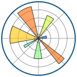
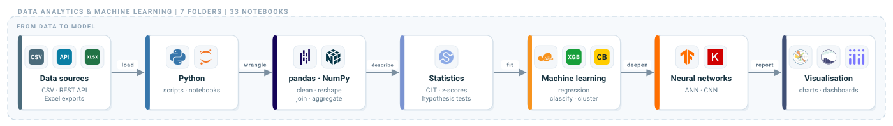
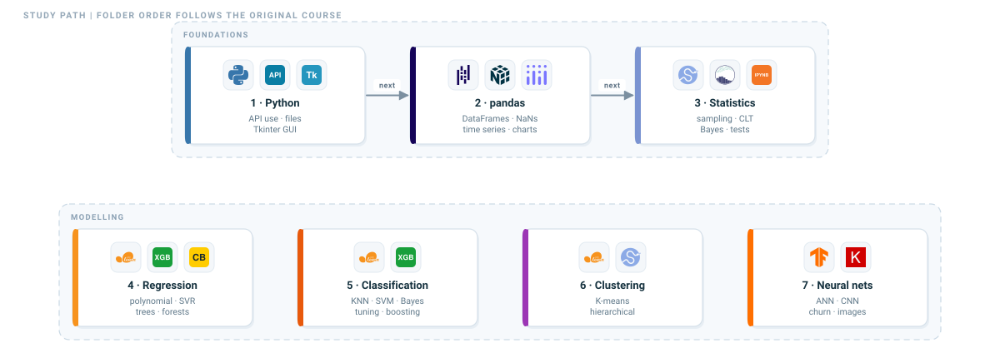

# Data Analytics & Machine Learning Projects

<p align="center">
  
  
  
  
  
  
  
  
  
  
  
</p>

A structured learning portfolio that walks from Python fundamentals through pandas-based data analysis and statistics, and on to the main families of machine learning models — regression, classification, clustering, and neural networks. Every topic is practised in a Jupyter notebook (plus a couple of standalone Python scripts), numbered in the order the material was studied.


## How the study path fits together

<p align="center">
  
</p>

Raw data comes in on the left; each box is a stage the notebooks walk through —
load it with Python, shape it with pandas, describe it with SciPy, then fit
progressively stronger models and finish with a chart.

<p align="center">
  
</p>

The same order as the folders below: three foundations, then four model families.

*Editable draw.io sources: [`assets/diagrams`](../assets/diagrams).*

---

## What is in here

| # | Folder | Focus | Libraries |
|---|--------|-------|-----------|
| 1 | `1. Python` | Core Python: API consumption, file handling, functions, Tkinter GUI | `requests`, `pandas`, `openpyxl`, `tkinter`, `PIL` |
| 2 | `2. Python Pandas` | DataFrames, cleaning, grouping, time series, performance, visualisation | `pandas`, `numpy`, `matplotlib`, `seaborn`, `plotly` |
| 3 | `3. Sampling, Central Limit Theorem, Probability theory, Hypothesis testing` | Descriptive statistics, CLT and z-scores, probability and Bayes, significance testing | `pandas`, `numpy`, `scipy`, `seaborn` |
| 4 | `4. Machine learning - Regressions` | Predicting continuous targets: polynomial linear, SVR, decision tree, random forest, model validation | `scikit-learn`, `xgboost`, `catboost`, `plotly` |
| 5 | `5. Machine learning - Classification` | Predicting classes: KNN, SVM, naive Bayes, trees, forests, tuning, boosting | `scikit-learn`, `xgboost`, `catboost` |
| 6 | `6. Machine learning - Clustering` | Unsupervised segmentation: K-means and hierarchical clustering | `scikit-learn`, `scipy` |
| 7 | `7. Machine learning - Neural networks` | ANN and CNN fundamentals, churn prediction, image classification | `tensorflow`, `keras`, `scikit-learn` |

---

## 1. Python

Two small projects that practise the language itself before any analysis:

| Path | Description |
|------|-------------|
| `Cinema data API use and data export/cinema_data_get_from_API.py` | Tkinter desktop app that searches **The Movie Database (TMDB) API v3** by title, lists matching films with release dates, and exports the full details of every result to `movies.xlsx` via pandas + openpyxl. The API key is read from a local `config.py`, and a resizable background image is handled with `PIL` / `ImageTk`. |
| `Open and edit file with functions/open_edit _file_with_functions.py` | Menu-driven CLI for maintaining a student list stored in `example_file_7.txt` — print, append, delete by index, delete by value, and search by name. |
| `Open and edit file with functions/task_logic_7.py` | The supporting module: one function per operation, all doing plain `open()` / read / write with `utf-8` encoding. |
| `Open and edit file with functions/example_file_7.txt` | The sample data file the CLI reads and rewrites. |

Notes: the console menu and comments are in **Latvian**; the file path is hard-coded (edit `filepath` before running).

---

## 2. Python Pandas

Progressive pandas practice on real datasets (wine reviews, crypto prices, world cities, wine quality):

| Notebook | Topic |
|----------|-------|
| `03. DataFrame. Getting Data, Filtering, NaNs, Assigning.ipynb` | Reading data, selecting/filtering rows and columns, handling NaNs, assigning new columns |
| `04. Data Grouping, Sorting, Mapping.ipynb` | `groupby`, sorting, `map`/`apply` style transformations |
| `05. Data Issues_ Missing, Inconsistency - uzlabota versija.ipynb` | Missing values and inconsistent records, cleaned end to end (Kickstarter + wine data) |
| `06. Time Series.ipynb` | Datetime parsing, resampling, time-based indexing |
| `07. Advanced Pandas. Performance.ipynb` | Faster patterns on a large city dataset |
| `08. Pandas Advanced. Zip(), Copy(), applymap(), parallel processing.ipynb` | `zip()`, copying semantics, `applymap`, parallel processing |
| `09. Data Visualization.ipynb` | Charts with matplotlib and seaborn (crypto prices, wine quality) |
| `Covid Map.ipynb` | Interactive choropleth of COVID data with **Plotly**; output captured in `Result_Covid _map.PNG` |

`05` is labelled *uzlabota versija* — Latvian for "improved version".

---

## 3. Statistics, probability and hypothesis testing

| Notebook | Topic |
|----------|-------|
| `10. Sampling, Mean, Median, Mode, Var, STD, Covariance, Correlation.ipynb` | Sampling and the core descriptive statistics, computed by hand and compared across datasets (crypto, iris, telco churn, weight/height) |
| `11. Central Limits Theorem, Z-Scores.ipynb` | Sampling distributions, the central limit theorem, z-scores |
| `12. Probability, Rule of Addition, Bayes_ Classifier, Naive Bayes.ipynb` | Probability rules, Bayes' theorem, and a first naive Bayes classifier |
| `13. Hypothesis Testing.ipynb` | Formulating hypotheses and running tests with `scipy.stats` on wine quality |

---

## 4. Machine learning - Regressions

Predicting a continuous target, one algorithm per notebook, all on the same `position_salaries.csv` so the models can be compared directly. `19` then compares and validates them.

| Notebook | Model / topic |
|----------|---------------|
| `15. Polynomial Linear Regression.ipynb` | Polynomial features on top of linear regression |
| `16. Support Vector Regression.ipynb` | SVR with feature scaling |
| `17. Descision Tree Regression.ipynb` | Decision tree regressor |
| `18. Random Forest.ipynb` | Random forest regressor (ensemble) |
| `19. Regression Validation.ipynb` | Validating regression models on `PP_Data.csv`, including boosted-tree models (`xgboost`, `catboost`) and Plotly comparison charts |

---

## 5. Machine learning - Classification

Classic supervised classification on `Social_Network_Ads.csv` (purchase prediction), plus boosting and a multi-algorithm bake-off.

| Notebook | Model / topic |
|----------|---------------|
| `21. KNN.ipynb` | K-nearest neighbours |
| `22. SVM.ipynb` | Linear support vector machine |
| `23. Non-Linear SVM.ipynb` | Kernel SVM (RBF) for a non-linear boundary |
| `24. Naive Bayes.ipynb` | Gaussian naive Bayes |
| `25. Decision Tree.ipynb` | Decision tree classifier |
| `26. Random Forest.ipynb` | Random forest classifier |
| `29. Tuning of Model.ipynb` | Systematic model tuning on the same dataset |
| `Classification with multiple algorithms.ipynb` | Side-by-side comparison of several classifiers on `data.csv` |
| `XGBoost and CatBoost classification.ipynb` | Gradient boosting with XGBoost and CatBoost on the Wisconsin breast-cancer dataset |

---

## 6. Machine learning - Clustering

| Notebook | Topic |
|----------|-------|
| `27. K-means Clustering.ipynb` | K-means segmentation of mall customers |
| `28. Hierarchical Clustering.ipynb` | Agglomerative clustering with a `scipy` dendrogram |

---

## 7. Machine learning - Neural networks

| Notebook | Topic |
|----------|-------|
| `31. Intro into ANN.ipynb` | First artificial neural network in TensorFlow/Keras on `PP_Data.csv` |
| `32. Churn Prediction with ANN.ipynb` | Customer-churn prediction on `Churn_Modelling.csv` |
| `33. Intro into CNN.ipynb` | Convolutional neural network fundamentals in TensorFlow |
| `ANN_Wine.ipynb` | ANN on the wine-quality dataset (Keras, with matplotlib/seaborn analysis) |
| `CNN_Classification.ipynb` | Multi-classifier comparison on `data.csv` with confusion matrices — despite the name it uses scikit-learn estimators (logistic regression, KNN, SVM, naive Bayes, decision tree, random forest) rather than a deep network |

---

## Datasets

The notebooks read these CSV files from their own folder. **The data files are not stored in this repository** — download them (or point the `read_csv` calls at your own copies) before running a notebook.

| Dataset | Used by |
|---------|---------|
| `winemag-data-130k-v2.csv` | pandas `03`, `04`, `05` |
| `ks-projects-201612.csv`, `2019_gads.csv` | pandas `05` (data-quality practice) |
| `L_05_worldcities.csv` | pandas `07` (performance) |
| `coin_*.csv` (23 crypto files) | pandas `09`, statistics `10`, `11` |
| `covid-latest.csv` | `Covid Map.ipynb` |
| `winequalityN.csv` | pandas `09`, `13`, `ANN_Wine.ipynb` |
| `Iris.csv`, `weight-height.csv`, `WA_Fn-UseC_-Telco-Customer-Churn.csv` | statistics `10` |
| `position_salaries.csv` | regression `15`–`18` |
| `PP_Data.csv` | regression `19`, ANN `31` |
| `Social_Network_Ads.csv` | classification `21`–`26`, `29` |
| `data.csv` | `Classification with multiple algorithms`, `CNN_Classification` |
| `Wisconsin.csv` | `XGBoost and CatBoost classification` |
| `Mall_Customers.csv` | clustering `27`, `28` |
| `Churn_Modelling.csv` | `32` |

---

## Running the notebooks

```bash
# 1. Environment
python -m venv .venv
.venv\Scripts\Activate.ps1        # Windows; use source .venv/bin/activate elsewhere

# 2. Dependencies used across the folders
pip install jupyter pandas numpy matplotlib seaborn scipy scikit-learn plotly
pip install xgboost catboost tensorflow openpyxl pillow requests

# 3. Start Jupyter and run a notebook from its own folder
jupyter lab
```

Run notebooks from the folder that contains their CSV, since the paths are relative.

For the cinema script, create a `config.py` beside it containing `api_key = "<your TMDB v3 key>"` and add an `img2.jpg` background — the file is set up for a specific local layout (`C:/Python/...`).

---

## Conventions

* Notebook numbers follow the original study order; the gaps (`01`, `02`, `14`, `20`, `30`) correspond to material not included here.
* A few files and comments are in **Latvian** (for example *uzlabota versija* = "improved version"), including the file-management CLI in `1. Python`.
* Notebooks are self-contained: each one repeats imports, loading, and plotting so a topic can be read on its own.

---

## Tools & Technologies

* **Language** — Python 3
* **Environment** — Jupyter Notebook / JupyterLab
* **Data analysis** — pandas, NumPy, SciPy
* **Visualisation** — matplotlib, seaborn, Plotly
* **Machine learning** — scikit-learn, XGBoost, CatBoost
* **Deep learning** — TensorFlow, Keras
* **Python practice** — `requests` (REST APIs), `tkinter`, Pillow, openpyxl

