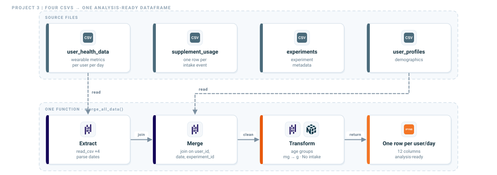

# Data Engineering Pipeline for Supplement Experiments

Cleaning and merging four related health and supplement datasets into one analysis-ready dataset for **1001-Experiments**, a company that builds personalized supplement regimens from wearable and health-app data.

---

## Business context

1001-Experiments runs many small experiments with its users to measure how supplements affect health outcomes. Health and activity data is collected from thousands of users through wearables and health apps, and it has to be joined with supplement intake, experiment metadata, and user demographics before any analysis or formulation change can happen.

Today that cross-referencing is done ad hoc across separate notebooks, which is slow and error-prone. The deliverable for this project is a single reusable function that replaces the manual joins.

<p align="center">
  
</p>

*Editable source: [`images/merge-flow.drawio`](images/merge-flow.drawio).*

---

## Data

Four CSV files, each covering roughly four months of activity:

| File | Description | Columns |
|------|-------------|---------|
| `user_health_data.csv` | Daily health metrics, habits, and wearable readings | `user_id`, `date`, `average_heart_rate`, `average_glucose`, `sleep_hours`, `activity_level` |
| `supplement_usage.csv` | One row per supplement intake event | `user_id`, `date`, `supplement_name`, `dosage`, `dosage_unit`, `is_placebo`, `experiment_id` |
| `experiments.csv` | Metadata about each experiment | `experiment_id`, `name`, `description` |
| `user_profiles.csv` | Demographic and contact information | `user_id`, `email`, `age` |


The sources share identifiers (`user_id`, `date`, `experiment_id`), so they cannot be combined without careful key handling and de-duplication.

---

## Task

Implement a single entry point:

```python
merge_all_data(
    'user_health_data.csv',
    'supplement_usage.csv',
    'experiments.csv',
    'user_profiles.csv'
)
```

The function must return a `pandas.DataFrame` with **one unique row per user per day**, combining health metrics with supplement usage, using exactly these columns:

| Column | Description |
|--------|-------------|
| `user_id` | Unique user identifier. Never missing. |
| `date` | Date of the health record or supplement intake, as a date. Never missing. |
| `email` | User contact email. Never missing. |
| `user_age_group` | One of `Under 18`, `18-25`, `26-35`, `36-45`, `46-55`, `56-65`, `Over 65`, or `Unknown` when the age is missing. |
| `experiment_name` | Experiment tied to the supplement usage. May be missing for users with health data only. |
| `supplement_name` | Supplement taken that day; days without intake are encoded as `No intake`. |
| `dosage_grams` | Dosage in grams — mg values are divided by 1000. May be missing on days without intake. |
| `is_placebo` | `True`/`False` placeholder flag. May be missing on days without intake. |
| `average_heart_rate` | Average heart rate recorded by the wearable. Missing values allowed. |
| `average_glucose` | Average glucose level recorded by the wearable. Missing values allowed. |
| `sleep_hours` | Total sleep in hours for the night preceding the current day's log. Missing values allowed. |
| `activity_level` | Activity score between 0 and 100. Missing values allowed. |

---

## Approach

The notebook breaks the work into small, testable steps that `merge_all_data` orchestrates:

1. **Extract** — load the four CSVs with `pandas.read_csv`.
2. **Merge** — parse the `date` columns to `datetime`, normalise `sleep_hours` (values arrive as strings such as `8.8h`), and join health data to supplement usage, experiments, and user profiles on the shared identifiers.
3. **Transform** — strip whitespace from string columns, convert mg dosages to grams, bucket raw ages into `user_age_group`, encode `No intake` for days without supplements, and order the columns as specified.
4. **Run** — call `merge_all_data(...)` on the bundled files and inspect the merged DataFrame.

---

## Contents

| File | Description |
|------|-------------|
| `notebook.ipynb` | Full solution: `extract`, `merging`, `transform`, and the `merge_all_data` entry point |
| `user_health_data.csv` | Health / wearable metrics |
| `supplement_usage.csv` | Supplement intake log |
| `experiments.csv` | Experiment metadata |
| `user_profiles.csv` | User demographics |
| `schema.png` | Entity relationship diagram of the four sources |
| `images/merge-flow.svg` | Four sources → one analysis-ready table (editable `.drawio` alongside) |

---

## Running the notebook

```bash
pip install pandas numpy
jupyter notebook notebook.ipynb
```

Run all cells top to bottom — the final cell calls `merge_all_data` on the bundled CSVs and displays the merged output.

---

## Tools & Technologies

* **Language** — Python
* **Libraries** — pandas, NumPy
* **Environment** — Jupyter Notebook
