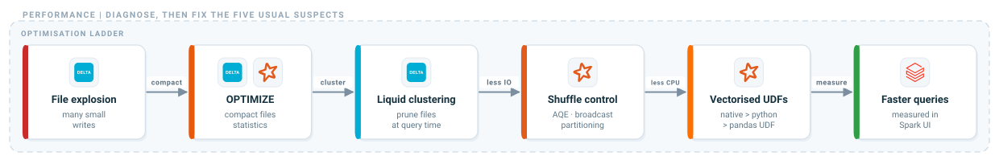

# Databricks Performance Optimization

Diagnosing and fixing the query and storage problems that show up in production lakehouse workloads: too many small files, missing data skipping, expensive shuffles, exploding joins, and slow user-defined functions.

  

*Editable source: [`images/perf-flow.drawio`](images/perf-flow.drawio).*

---

## What is covered

* **File explosion** — how small files are created by frequent writes, and how to compact them
* **Data skipping and liquid clustering** — how Delta Lake prunes files at query time, and how clustering keys improve it
* **Shuffle** — why shuffles dominate Spark execution time, and how to reduce or reuse them
* **Exploding joins** — row-count blow-ups from non-unique join keys, and how to detect and avoid them
* **User-defined functions** — the cost difference between native functions, Python UDFs, and vectorized UDFs

---

## Notebooks

| Notebook | Type | Description |
|----------|------|-------------|
| `PO 1.1 - File Explosion.ipynb` | Demo | Small-file problem, measurement, and compaction |
| `PO 1.2L - Data Skipping and Liquid Clustering.ipynb` | Lab | Compare skipping behaviour with and without clustering |
| `PO 1.3 - Shuffle.ipynb` | Demo | Shuffle mechanics and partitioning strategies |
| `PO 1.4L - Exploding Join.ipynb` | Lab | Diagnose and fix an exploding join |
| `PO 1.5 - User-Defined Functions.ipynb` | Demo | Performance comparison of UDF approaches |

---

## How to use

Each notebook sets up the data it needs, then measures performance before and after the optimization. Run the cells in order and compare the execution plans (`EXPLAIN` / Spark UI) and runtimes between the two versions.

---

## Prerequisites

* A Databricks cluster with a recent Databricks Runtime (liquid clustering requires a runtime that supports it)
* Unity Catalog enabled, with permission to create a schema for the demo tables
* Spark UI access to inspect shuffle read/write and file statistics

---

## Tools & Technologies

* Delta Lake — `OPTIMIZE`, liquid clustering, data skipping statistics
* Apache Spark — partitioning, shuffles, broadcast joins, adaptive query execution
* Spark UI and `EXPLAIN` for diagnostics
