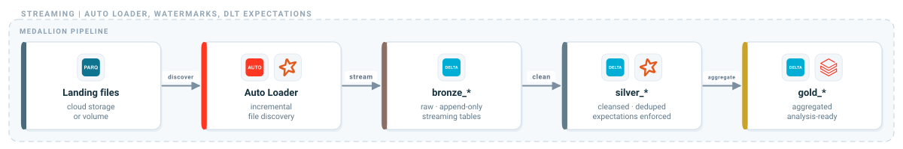

# Databricks Streaming

Structured Streaming and **Delta Live Tables** end to end: running continuously updating queries, aggregating over event time with watermarks, joining two streams, and building a Bronze → Silver medallion pipeline with Auto Loader and data-quality expectations.

<p align="center">
  
</p>

*Editable source: [`images/streaming-flow.drawio`](images/streaming-flow.drawio).*

---

## What is covered

| Area | Notebook |
|------|----------|
| Streaming query fundamentals | `SDLT 1.2L - Streaming Query Lab.ipynb` |
| Stream aggregations | `SDLT 1.3L - Stream Aggregations Lab.ipynb` |
| Windowed aggregation with watermarks for late data | `SDLT 1.4 - Windowed Aggregation with Watermark.ipynb` |
| Stream-stream joins | `SDLT 1.5 - Optional - Stream-Stream Joins.ipynb` |
| Auto Loader ingestion into a Bronze table | `SDLT 2.1.1 - Auto Load to Bronze.ipynb` |
| Multiplex Bronze pattern — one source table feeding several streams | `SDLT 2.2.1 - Stream from Multiplex Bronze.ipynb` |
| Data-quality enforcement with expectations | `SDLT 2.3.1 - Data Quality Enforcement.ipynb` |
| End-to-end streaming ETL | `SDLT 2.4L - Streaming ETL Lab.ipynb`, `SDLT 2.4.1L - Streaming ETL Lab.ipynb` |

---

## Pipeline pattern

```
Files (cloud storage / volume)
        │  Auto Loader (read_files / cloudFiles)
        ▼
   bronze_*  ── raw, append-only streaming tables
        │
        ▼
   silver_*  ── cleansed, deduplicated, quality-checked
        │
        ▼
   gold_*    ── aggregated, analysis-ready
```

The notebooks in the `2.x` series build this pattern step by step in **Delta Live Tables SQL**, starting from Auto Loader ingestion and ending with a complete pipeline that enforces expectations on the way through.

---

## Prerequisites

* A Databricks workspace with **Delta Live Tables** available
* Unity Catalog enabled, plus a schema for the pipeline's tables
* Access to a landing location for the streaming files (the labs use paths available in the workspace, such as `/databricks-datasets`)
* A cluster running a runtime that supports DLT and Auto Loader

---

## Notes

* `SDLT 1.5 - Optional - Stream-Stream Joins.ipynb` is marked optional and can be skipped without affecting the `2.x` labs.
* `SDLT 2.4.1L` is the extended version of the `SDLT 2.4L` ETL lab.
* Notebooks reference `<catalog>.<schema>` placeholders — set them to your own catalog and schema before running.

---

## Tools & Technologies

* Delta Live Tables (declarative pipelines, expectations)
* Auto Loader, structured streaming, watermarks, stream-stream joins
* Delta Lake, Unity Catalog
