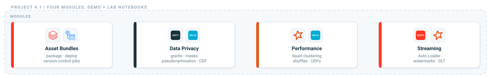

# Advanced Databricks Data Engineering Examples

A workshop-style set of demo and lab notebooks covering the Databricks features that come up in day-to-day data engineering work: deployment automation, data privacy and governance, query performance, and streaming pipelines.

  

*Editable source: [`images/modules.drawio`](images/modules.drawio).*

---

## Modules

| Module | Focus | Notebooks |
|--------|-------|-----------|
| [Automated deployment with Databricks Asset Bundles](Automated%20deployment%20with%20Databricks%20Asset%20Bundles) | Packaging, deploying, and version-controlling Databricks jobs and pipelines as code | 7 notebooks + 6 bundle `.zip` sources |
| [Databricks Data Privacy](Databricks%20Data%20Privacy) | Unity Catalog security, PII handling, pseudonymization/anonymization, propagating changes with Change Data Feed | 6 notebooks |
| [Databricks Performance Optimization](Databricks%20Performance%20Optimization) | File explosion, data skipping and liquid clustering, shuffle, exploding joins, user-defined functions | 5 notebooks |
| [Databricks Streaming](Databricks%20Streaming) | Streaming queries and aggregations, watermarking, stream-stream joins, Auto Loader and DLT streaming ETL | 9 notebooks |

---

## Conventions used in the notebooks

* **`Demo - ...`** notebooks are instructor-led walkthroughs.
* **`Lab - ...`** notebooks are exercises with blanks to complete; the trailing `L` in the streaming series (`1.2L`, `1.3L`, `2.4L`) follows the same convention.
* Notebooks reference Unity Catalog objects through placeholders such as `<catalog>.<schema>` — replace them with your own catalog and schema before running.

---

## Prerequisites

* A Databricks workspace with Unity Catalog enabled
* Delta Live Tables available in the workspace
* Cluster access to `/databricks-datasets` (for the streaming module)
* For the Asset Bundles module: Databricks CLI, a personal access token, and (optionally) a Git provider for the CI/CD demo

---

## Contents

| Path | Description |
|------|-------------|
| `Automated deployment with Databricks Asset Bundles/` | Deployment automation module |
| `Databricks Data Privacy/` | Data privacy and governance module |
| `Databricks Performance Optimization/` | Query and storage performance module |
| `Databricks Streaming/` | Streaming and DLT module |

---

## Tools & Technologies

* Databricks Asset Bundles, Databricks CLI, GitHub Actions (CI/CD demo)
* Unity Catalog (grants, row filters, column masks, dynamic views)
* Delta Lake — Change Data Feed, liquid clustering, data skipping, optimization
* Delta Live Tables, Auto Loader, structured streaming
