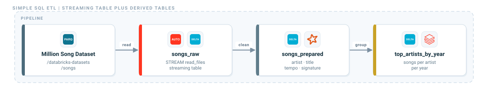

# Simple Databricks ETL Workflow with SQL

A compact example of declarative pipelines in pure **Delta Live Tables SQL**: ingest a public dataset with `read_files`, prepare it in a derived table, and answer business questions with SQL.

  

*Editable source: [`images/dlt-sql-flow.drawio`](images/dlt-sql-flow.drawio).*

---

## Pipeline

| Object | Type | Description |
|--------|------|-------------|
| `songs_raw` | Streaming table | Raw ingestion from the Million Song Dataset stored in `/databricks-datasets/songs/data-001/part*` using `STREAM read_files(...)` |
| `songs_prepared` | Derived table | Cleaned and prepared song attributes (artist, title, tempo, time signature, …) |
| `top_artists_by_year` | Derived table | Number of songs released per artist by year |

## Example analysis queries

* Artists with the most songs in a year (from 1990 onwards), ordered by song count
* Songs with a 4/4 time signature and a danceable tempo (100–140 BPM)

---

## Files

| File | Description |
|------|-------------|
| `databricks_etl_sql.ipynb` | DLT SQL pipeline definition plus analysis queries |
| `images/dlt-sql-flow.svg` | Pipeline diagram (editable `.drawio` alongside) |

---

## Prerequisites

* A Databricks workspace with **Delta Live Tables** and **Unity Catalog** enabled
* A catalog and schema for the output tables
* Cluster access to `/databricks-datasets` (bundled with Databricks workspaces)

---

## Running the pipeline

1. Point a DLT pipeline at `databricks_etl_sql.ipynb` and choose the target catalog/schema.
2. Replace the `<catalog>.<schema>` placeholders in the analysis queries with your catalog and schema.
3. Start the pipeline to create the streaming and derived tables, then run the query cells.

---

## Tools & Technologies

* Delta Live Tables SQL (`CREATE OR REFRESH STREAMING TABLE`)
* Delta Lake, Auto Loader-style `read_files`
* Spark SQL
