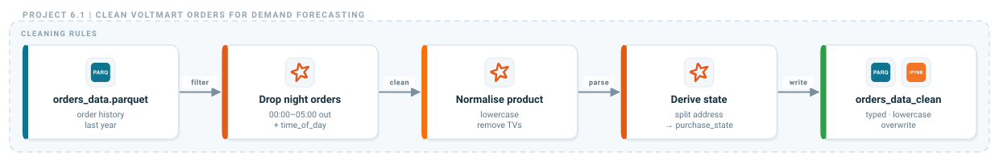

# Cleaning Data with PySpark

Cleaning **Voltmart**'s order history (an electronics e-commerce company) so the Machine Learning team can build a demand-forecasting model on top of it. The ML team specified the exact output table format, and this workflow applies those rules with PySpark.

<p align="center">
  
</p>

*Editable source: [`images/cleaning-flow.drawio`](images/cleaning-flow.drawio).*

---

## Input

`orders_data.parquet` — one row per order placed last year.

| Column | Type | Description | Cleaning requirement |
|--------|------|-------------|----------------------|
| `order_date` | timestamp | Date and time the order was made | Remove orders placed between 12am and 5am (inclusive); convert from timestamp to date |
| `time_of_day` | string | Period of the day the order was made | New column containing `morning` (5–12), `afternoon` (12–18), `evening` (18–24), lower bound inclusive, upper bound exclusive |
| `order_id` | long | Order ID | — |
| `product` | string | Name of the product ordered | Remove rows containing `TV` — the company no longer sells it; ensure all values are lowercase |
| `product_ean` / `product_id` | double | Product ID | — |
| `category` | string | Broader product category | Ensure all values are lowercase |
| `purchase_address` | string | Address line where the order was made (`House Street, City, State Zipcode`) | — |
| `purchase_state` | string | US state of the purchase address | New column containing the state the order was placed from |
| `quantity_ordered` | long | Number of product units ordered | — |
| `price_each` | double | Price per product unit | — |
| `cost_price` | double | Cost of production per product unit | — |
| `turnover` | double | Total amount paid for the product (quantity × price) | — |
| `margin` | double | Profit made on the product (turnover − cost) | — |

---

## Transformation steps

1. Create `time_of_day` with `F.when(...).otherwise(None)` over `F.hour('order_date')`, bucketing hours into `night`, `morning`, `afternoon`, and `evening`.
2. Filter out `night` orders — this removes everything placed between 12am and 5am inclusive.
3. Cast `order_date` from timestamp to `DateType`.
4. Lowercase `product` and `category`, then drop rows where `product` contains `tv`.
5. Derive `purchase_state` by splitting `purchase_address` on spaces and taking the second-to-last element, then drop the temporary split column.
6. Count the distinct states as a quick sanity check.
7. Write the cleaned table to `orders_data_clean.parquet` with `mode='overwrite'`.

---

## Files

| File | Description |
|------|-------------|
| `notebook.ipynb` | Cleaning and transformation workflow |
| `orders_data.parquet` | Raw order data |
| `ecommerce_analytics-1224x532.jpg` | Project illustration |
| `images/cleaning-flow.svg` | Cleaning flow diagram (editable `.drawio` alongside) |
| `orders_data_clean.parquet` | Output — created when the notebook runs |

---

## Running the notebook

```bash
pip install pyspark pyarrow pandas
jupyter notebook notebook.ipynb
```

Run the cells in order. The final cell writes `orders_data_clean.parquet` next to the notebook.

---

## Tools & Technologies

* **Language** — Python
* **Engine** — PySpark (`SparkSession`, `pyspark.sql.functions`, `pyspark.sql.types`)
* **Format** — Parquet
