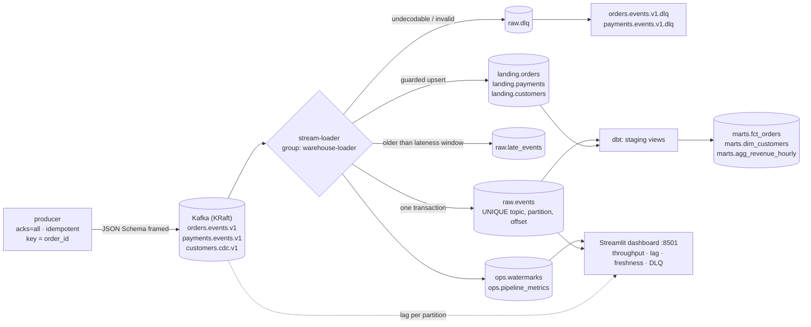

# Streaming Pipeline — Kafka to Data Warehouse

An end-to-end streaming pipeline that ingests event data from **Apache Kafka** and lands it in a **PostgreSQL warehouse** without duplicating or losing a single row — even when the producer retries, events arrive out of order, messages are months late, or payloads are corrupt.

It is built to be *operated*, not just demoed: explicit topic provisioning, schema governance, dead-letter handling, watermarking, idempotent upserts, per-partition lag monitoring, dbt models with a late-arrival lookback, and a CI job that proves the invariants on every push.

Everything below was measured on a real local run of this repository (see [Verified results](#verified-results)).

---

## Architecture



| Layer | Schema | Written by | Guarantee |
|-------|--------|-----------|-----------|
| Raw log | `raw.events`, `raw.dlq`, `raw.late_events` | loader | Append-only, replayable, one row per Kafka record |
| Landing | `landing.*` | loader | Current state per entity, idempotent upsert |
| Staging | `staging.*` | dbt | Typed views with derived flags |
| Marts | `marts.*` | dbt | Fact, dimension (SCD2), hourly aggregate |
| Ops | `ops.*` | loader + monitoring | Watermarks, metrics, health view |

---

## Quickstart

```bash
cp .env.example .env          # or: make env
docker compose up -d --build  # kafka, schema-registry, kafka-ui, postgres, loader, dbt loop
open http://localhost:8080    # kafka-ui (topics, consumer groups, messages)
open http://localhost:8501    # monitoring dashboard (throughput, lag, DLQ, freshness)
```

The `producer` service publishes 1 000 events on startup so the pipeline has data immediately. To run the full fault-injection scenario:

```bash
./scripts/smoke_test.sh       # infra → topics → produce → load → verify → dbt → lag report
```

Individual steps:

```bash
make up        # infrastructure + topics + loader + dbt loop
make produce   # 5000 events: 5% duplicates, 2% late, 3% out of order, 0.1% malformed
make load      # run the loader until the topics are drained
make dbt       # dbt build (models + data tests)
make verify    # warehouse invariant checks
make lag       # per-partition lag / freshness / dead-letter report
make down      # stop (volumes kept);  make clean  → also delete volumes
```

---

## Verified results

Local run, `--count 2000 --duplicate-rate 0.05 --late-rate 0.02 --out-of-order-rate 0.03 --malformed-rate 0.002`:

| Measurement | Value |
|---|---|
| Events generated / published | 2 000 → **2 096** records (96 deliberate duplicates), ~660 events/s, 0 delivery failures |
| Injected faults | 43 late, 53 out of order, 5 malformed |
| Loader: records consumed | **2 096** |
| `raw.events` rows inserted | **2 091** (the 5 malformed records never entered raw) |
| Dead letters | **5** (all malformed payloads, classified `deserialization`) |
| Late events quarantined | **45** (43 injected + 2 duplicated late records) |
| `landing.orders` / `payments` / `customers` | **1 088** / **348** / **112** rows |
| Duplicate keys in `landing.orders` | **0** |
| Upstream events rejected by the `updated_at` guard | **1** during load, **46** on replay |
| dbt build | **49 / 49 nodes pass** (3 views, 2 incremental models, 1 table, 1 snapshot, 42 data tests), 0 warnings |
| Consumer lag after load | **0** on all 12 partitions (max = total = 0) |
| Unit / integration tests | **32 passed** / **10 passed** |
| Dashboard headless render | **10 metrics, 5 tabs, 0 exceptions, 0 warnings** |

**The replay proof.** Reset the consumer group to `earliest` and run the loader again over the same 2 096 records:

```
records=2096 raw_inserted=0 raw_duplicates=2091
orders=1088 orders_ignored_stale=46 payments=348 customers=112
dead_letters=0 late_events=0
```

Zero new rows, zero new dead letters, zero new late events, and the entity tables re-converge on exactly the same keys. That is at-least-once transport plus idempotent storage behaving as exactly-once *as observed in the warehouse*.

---

## Event contracts

Topics are provisioned explicitly (`src/setup/init_topics.py`), never auto-created. Payloads are validated against JSON Schema and registered in Schema Registry with `BACKWARD` compatibility.

| Topic | Partitions | Key | Cleanup | Purpose |
|-------|-----------|-----|---------|---------|
| `orders.events.v1` | 6 | `order_id` | delete, 7 d | Order lifecycle (`order_created`, `order_updated`, `order_cancelled`) |
| `payments.events.v1` | 3 | `order_id` | delete, 7 d | Payment attempts and settlement |
| `customers.cdc.v1` | 3 | `customer_id` | **compact**, 30 d | Customer change events (upsert/delete) |
| `<topic>.dlq` | 1 | original key | delete, 14 d | Messages that can never be processed |

```json
{
  "event_id": "0f8b…-…",
  "event_type": "order_created",
  "event_time": "2026-11-25T16:55:21.442Z",
  "order_id": "ord_9c1a7f3b2e04",
  "customer_id": "cus_4b7d1e90c2a8",
  "store_id": 7,
  "status": "created",
  "currency": "EUR",
  "amount": 412.37,
  "item_count": 3,
  "schema_version": 1
}
```

Wire format is the standard Confluent framing: `0x00` magic byte + 4-byte schema id + JSON body (`src/loader/decoding.py`). Decoding explicitly means a *non-framed* payload is recognised as a deserialization error instead of crashing the poll loop, and its bytes can be forwarded to the DLQ untouched.

---

## Delivery semantics

| Failure | What happens | Why it is safe |
|---------|--------------|----------------|
| Producer retries a send | Idempotent producer assigns PID + sequence numbers; broker dedupes | `enable.idempotence=true`, `acks=all`, `retries=10` |
| Loader crashes after DB commit, before offset commit | Batch is re-delivered | Offsets are committed **only after** the transaction returns |
| Loader crashes mid-transaction | Transaction rolls back, batch is re-delivered | Single transaction per poll batch |
| Same record consumed twice | Second insert hits `UNIQUE (topic, partition_id, kafka_offset)` | `ON CONFLICT DO NOTHING` |
| Reprocessing / backfill (group reset) | Rows are re-upserted with identical values | Upsert guarded by `EXCLUDED.updated_at >= target.updated_at` |
| Older event arrives after a newer one | Update is skipped, event still visible in `raw.events` | `WHERE EXCLUDED.updated_at >= target.updated_at` |
| Poison message (bad JSON / schema violation) | Row in `raw.dlq` + message on `<topic>.dlq` with diagnostic headers | Loop continues; no partition is blocked |
| Event older than the lateness window | Quarantined in `raw.late_events`, not applied to state | Watermark tracked per topic in `ops.watermarks` |
| Schema change | Registry rejects incompatible versions at produce time | `BACKWARD` compatibility + `src/setup/register_schemas.py` |

Dead letters carry `x-error-class`, `x-error-message`, `x-failed-at` plus the original headers, so triage does not require opening payloads.

---

## Best practices applied (and where)

| Practice | Implementation |
|---|---|
| `acks=all` + idempotent producer + retries | [`src/producer/produce.py`](src/producer/produce.py) |
| Deliberate partitioning / keys for ordering | `src/setup/init_topics.py`, topic table above |
| Compression + batching tuned, `flush()` on exit | `compression.type=zstd`, `linger.ms=20`, delivery callbacks |
| Schema Registry with explicit compatibility, auto-register off in prod | `src/setup/register_schemas.py`, `SCHEMA_AUTO_REGISTER` |
| No auto topic creation; topics as code | `KAFKA_AUTO_CREATE_TOPICS_ENABLE=false` + `init_topics.py` |
| Sink idempotency via upsert on a primary key (never blind `INSERT`) | `UPSERT_ORDER` / `UPSERT_PAYMENT` / `UPSERT_CUSTOMER` in `src/loader/warehouse.py` |
| Commit offsets only after the warehouse commit | `WarehouseLoader._handle_batch` |
| Manual commits, bounded poll size, cooperative rebalancing | `enable.auto.commit=false`, `BATCH_SIZE`, `cooperative-sticky` |
| DLQ with capped retries, metadata headers, separate quarantine table | `src/loader/dlq.py`, `raw.dlq`, `<topic>.dlq` |
| Event-time lateness policy with a watermark per topic | `src/loader/rules.py`, `ops.watermarks` |
| Replayable raw landing zone | `raw.events` + unique offsets |
| Micro-batch writes, one round-trip per key | `latest_per_key()` consolidation before upsert |
| Incremental models with a late-arrival lookback | `dbt_project/models/marts/fct_orders.sql` (`incremental_lookback_hours`) |
| Consumer lag per partition, `max()` not `avg()` | [`src/monitoring/lag_report.py`](src/monitoring/lag_report.py) |
| Freshness measured on event time | `ops.pipeline_health` / lag report |
| Idempotency and uniqueness enforced by tests, not hope | `pytest`, `scripts/verify.py`, dbt data tests, CI job |

Sources used while building this: [Kafka producer configs](https://kafka.apache.org/41/configuration/producer-configs), [Confluent JDBC sink — idempotent writes](https://docs.confluent.io/kafka-connectors/jdbc/current/sink-connector/overview.html), [Schema evolution practices](https://www.conduktor.io/glossary/schema-evolution-best-practices), [Kafka data observability](https://factorhouse.io/articles/best-practices-kafka-data-observability), [DLQ patterns](https://karafka.io/docs/Kafka-Best-Practices), [late-arriving data / watermarks](https://streamkap.com/resources-and-guides/late-arriving-data-streaming), [dbt incremental models](https://docs.getdbt.com/docs/build/incremental-models) and [microbatch](https://docs.getdbt.com/docs/build/incremental-microbatch), [Snowflake streaming ingestion](https://www.mimacom.com/learning-hub/data-streaming-in-snowflake), [KRaft compose example](https://kafkabackup.com/blog/kafka-kraft-docker-compose).

---

## Warehouse layer (dbt)

| Model | Materialization | Detail |
|-------|-----------------|--------|
| `stg_orders`, `stg_payments`, `stg_customers` | view | Typed columns plus derived flags (`order_hour`, `is_realised`, `is_captured`, soft-delete filter) |
| `fct_orders` | incremental, `merge` on `order_id` | Joins payment rollup; reprocesses the last `incremental_lookback_hours` (default 2) so late corrections land |
| `dim_customers` | table | Built from the SCD2 snapshot **union** every customer seen on an order; `is_known_customer` flags dimension-only rows |
| `agg_revenue_hourly` | incremental, `delete+insert` on `(order_hour, currency)` | Hourly revenue, cancellations, realised revenue |
| `snap_customers` | snapshot (timestamp strategy) | SCD2 history driven by the customer CDC topic |
| `assert_no_duplicate_order_per_day` | singular test | Fails if the fact table ever stops being unique per order |

The lookback is the important part: a strict `> max(event_time)` watermark would silently drop the corrections that the loader deliberately accepts. `dbt build` runs models **and** 42 data tests (uniqueness, not-null, accepted values, referential integrity, plus source freshness via `dbt source freshness`).

---

## Operating it

```bash
docker compose run --rm producer src.monitoring.lag_report --write-metrics
```

```
topic                    partition   committed        high     lag
orders.events.v1                 0         278         278       0
...
customers.cdc.v1                 2          50          50       0
total lag: 0   max partition lag: 0

topic                      freshness_s   watermark records
customers.cdc.v1                   174                 338
orders.events.v1                   171                3088
payments.events.v1                 171                 756
```

* **Lag is reported per partition** and summarised with `max()` — averaging hides the single stalled partition that actually breaks an SLO.
* **Freshness is measured on `event_time`**, so it reflects data staleness rather than bytes moved.
* `--fail-on-lag N` turns the report into a CI gate; `--write-metrics` persists the numbers to `ops.pipeline_metrics`.

### Runbook

| Symptom | Likely cause | Action |
|---|---|---|
| Lag growing on one partition | Poison message or a hot key | Check `raw.dlq` for that partition; the loader skips bad records, so lag means the consumer is down or slow |
| `raw.dlq` filling up | Upstream contract change | Compare `x-error-message` with the registered schema; fix upstream or register a compatible version |
| `raw.late_events` spiking | Producer clock skew or backfill | Tune `MAX_LATENESS_SECONDS`; reconcile late rows separately |
| Freshness rising, lag flat | Producer stopped | Check the producer/upstream, not the loader |
| `orders_ignored_stale` rising | Out-of-order or replayed events | Expected on replays; investigate only if it grows without replays |

---

## Monitoring dashboard

A Streamlit service (`dashboard`, port **8501**) turns the warehouse and broker state into something you can watch while a load runs. It is read-only: a dedicated connection is forced to `default_transaction_read_only = on`.

```bash
docker compose up -d dashboard     # or: make dashboard
open http://localhost:8501
```

| Panel | Shows | Source |
|---|---|---|
| **KPI strip** | raw records, orders, payments, max partition lag (+ total), open dead letters, worst freshness | `raw.*`, `landing.*`, broker |
| **📈 Throughput** | events ingested per minute per topic, peak rate, per-topic health table | `raw.events` |
| **⏱️ Consumer lag** | lag per partition as a bar chart + table, largest backlog callout | Kafka `AdminClient` |
| **☠️ Dead letters** | volume by error class, most recent failures with the error message | `raw.dlq` |
| **🕰️ Late events** | quarantined events with their lateness in seconds | `raw.late_events` |
| **🏗️ Warehouse** | rows per table, raw→landing coverage, metric history | `landing.*`, `ops.pipeline_metrics` |

Behaviour worth knowing:

* **Auto-refresh** (2–30 s, default 5 s) re-runs the script; the sidebar can disable it, and `DASHBOARD_AUTO_REFRESH=0` sets the default for headless runs.
* **Alerting thresholds** live at the top of `dashboard.py`: `LAG_WARN = 100` records and `FRESHNESS_WARN_SECONDS = 900` (matching the dbt source-freshness warning). A breach turns the status banner amber and names the cause.
* **Lag is per partition** — the KPI shows the maximum, and the tab highlights the worst partition, because an average hides a stalled one.
* **Caching** is 2–5 s per query, so clicking around does not hammer the database; **Reload now** clears it.

The dashboard is covered by tests: the query layer is exercised in `tests/test_dashboard.py`, and `scripts/check_dashboard.py` renders the whole app headlessly with Streamlit's own test harness and fails on any exception.

```bash
docker compose run --rm producer scripts.check_dashboard
# rendered: 10 metrics, 5 tab group(s)
# dashboard renders cleanly
```

---

## Repository layout

```
.
├── docker-compose.yaml            # kafka (KRaft), schema-registry, kafka-ui, postgres, loader, dbt loop
├── docker/
│   ├── app/Dockerfile             # python 3.12 + confluent-kafka, psycopg, dbt
│   ├── connect/Dockerfile         # optional Connect image (JDBC sink profile)
│   └── postgres/init/             # schemas, tables, constraints, health view
├── src/
│   ├── common/{config,schemas,logging}.py
│   ├── producer/{generate_events,produce}.py
│   ├── loader/{consumer,warehouse,dlq,decoding,rules}.py
│   ├── monitoring/{lag_report,dashboard}.py
│   └── setup/{init_topics,register_schemas}.py
├── dbt_project/                   # staging, marts, snapshot, singular test, macros
├── connect/jdbc-sink.json         # documented alternative sink
├── scripts/                       # smoke_test.sh, create_topics.sh, verify.py, check_dashboard.py
├── tests/                         # 32 unit + 10 integration tests
├── Makefile
└── .github/workflows/ci.yml
```

---

## Tests and CI

```bash
pytest -m "not integration"   # 32 passed — schemas, dedupe, lateness, dashboard helpers
pytest -m integration         # 10 passed — warehouse invariants + every dashboard query
ruff check src tests scripts  # clean
python -m scripts.check_dashboard   # renders the app headlessly, fails on exceptions
```

The unit tests need no broker: they cover the pure rules (`latest_per_key`, `is_late`, `dlq_headers`) and the schema contracts. The integration tests assert on real data:

* `raw.events` has no duplicate `(topic, partition_id, kafka_offset)`
* `landing.orders` has no duplicate `order_id`
* every late event is also present in `raw.events`
* no dead letter lacks an error class
* watermarks are populated
* every dashboard query returns its expected columns

CI (`.github/workflows/ci.yml`) runs lint → unit tests → `docker compose up --wait` → topics + schema registration → fault-injected produce → load → `scripts.verify` → `dbt build` → integration tests → dashboard render check → lag gate.

---

## Alternative sink: Kafka Connect JDBC (no custom code)

The same warehouse write can be done by a connector instead of the Python loader. It ships here as an optional Compose profile plus a ready config:

```bash
docker compose --profile connect up -d --build connect    # needs internet on first build
curl -X POST -H 'Content-Type: application/json' \
  --data @connect/jdbc-sink.json http://localhost:8083/connectors
```

[`connect/jdbc-sink.json`](connect/jdbc-sink.json) uses the settings that make connector writes safe:

| Setting | Value | Why |
|---|---|---|
| `insert.mode` | `upsert` | Idempotent on replay; `insert` would fail on the primary key or duplicate rows |
| `pk.mode` / `pk.fields` | `record_key` / `order_id` | The Kafka key *is* the primary key |
| `value.converter` | `JsonSchemaConverter` + registry URL | Decodes the framed payload using the registered schema |
| `errors.tolerance` | `all` | One bad record must not stop the task |
| `errors.deadletterqueue.topic.name` | `orders.events.v1.dlq` | Quarantine instead of silent loss |
| `batch.size` / `max.retries` | 500 / 10 | Bounded micro-batches with capped retries |

### Connector vs. code

| | Kafka Connect JDBC | This Python loader |
|---|---|---|
| Code to own | Config only | ~600 lines + tests |
| Ops surface | JVM, Connect cluster, connector upgrades | Python process |
| Lateness policy | Not supported (writes whatever arrives) | Quarantine + watermark |
| Raw replay layer | Not written | `raw.events` (append-only) |
| Custom routing | Limited to SMTs | Full control |
| Idempotency | `upsert` on the key | `upsert` + `updated_at` guard |
| Dead letters | Connector DLQ topic | DLQ topic **and** `raw.dlq` table |

**Rule of thumb:** a connector for "topic mirrors a table" workloads; a loader when the warehouse needs lateness rules, quarantine, or a replayable raw layer.

---

## Configuration

| Variable | Default | Purpose |
|---|---|---|
| `KAFKA_BOOTSTRAP_SERVERS` | `kafka:19092` | Broker (in-network listener) |
| `SCHEMA_REGISTRY_URL` | `http://schema-registry:8081` | Schema Registry |
| `SCHEMA_AUTO_REGISTER` | `true` | Set to `false` in production and pre-register via `make schemas` |
| `TOPIC_ORDERS` / `TOPIC_PAYMENTS` / `TOPIC_CUSTOMERS` | `*.v1` | Topic names |
| `CONSUMER_GROUP` | `warehouse-loader` | Consumer group |
| `BATCH_SIZE` | `500` | Records per poll/transaction |
| `MAX_LATENESS_SECONDS` | `3600` | Lateness window before quarantine |
| `POSTGRES_*` | `warehouse` / `warehouse` | Warehouse connection |
| `POSTGRES_HOST_PORT` | `5434` | Host port (5433 belongs to project 1) |
| `DBT_REFRESH_SECONDS` | `300` | dbt loop interval |

---

## Limitations and what changes at scale

* **PostgreSQL stands in for a cloud warehouse.** Mapping to production: `raw.events` → Snowflake **Snowpipe Streaming** (~5 s end-to-end) or BigQuery **Storage Write API**; `landing.*` → the same upsert semantics via `MERGE`; the dbt models are unchanged. The contracts and delivery guarantees carry over.
* **Single-node Kafka** (`replication.factor=1`, `min.insync.replicas=1`). The production pairing is `RF=3` + `min.insync.replicas=2` with `acks=all`.
* **No transactional exactly-once into the warehouse.** That needs Kafka transactions *and* a transactional sink, which plain Postgres does not offer. The design deliberately picks at-least-once transport plus idempotent storage — what most warehouses actually support.
* **`updated_at` ordering assumes meaningful event time.** With clock-skewed producers, use a sequence number or version column instead.
* **Offsets live in Kafka**, so a rebalance can replay the last batch; per-batch idempotency makes that harmless, but a batch may be processed twice.
* **The dbt runner is a loop, not a scheduler.** At scale that becomes Airflow / Dagster / Prefect — project 1 in this repository shows the Airflow pattern.
* **Not covered:** per-tenant partitioning, secrets management (Vault/SOPS), TLS/SASL, PII masking, multi-broker failover testing.

---

## Contents

| Path | Description |
|------|-------------|
| `README.md` | This document |
| `docker-compose.yaml` | Kafka (KRaft), Schema Registry, Kafka UI, Postgres, loader, dbt loop, optional Connect |
| `.env.example` | Every setting, with production notes |
| `src/producer/generate_events.py` | Seeded synthetic events + fault injection |
| `src/producer/produce.py` | Idempotent producer with delivery callbacks |
| `src/loader/consumer.py` | Poll → validate → transactional write → commit |
| `src/loader/warehouse.py` | Idempotent SQL (raw insert, guarded upserts, watermarks) |
| `src/loader/dlq.py` | Dead-letter publishing with diagnostic headers |
| `src/loader/decoding.py` | Confluent wire-format decoding |
| `src/loader/rules.py` | Lateness, dedupe and header rules (pure, unit tested) |
| `src/setup/init_topics.py` | Topics as code |
| `src/setup/register_schemas.py` | Schema registration + compatibility gate |
| `src/monitoring/lag_report.py` | Per-partition lag, freshness, DLQ report |
| `src/monitoring/dashboard.py` | Streamlit monitoring dashboard (port 8501) |
| `scripts/check_dashboard.py` | Headless render check for the dashboard (CI) |
| `dbt_project/` | Staging, marts, SCD2 snapshot, data tests |
| `scripts/smoke_test.sh` | Full end-to-end scenario |
| `scripts/verify.py` | Invariant checks (CI gate) |
| `tests/` | 20 unit + 5 integration tests |
| `connect/jdbc-sink.json` | Connector alternative |

---

## Tools & Technologies

* **Streaming** — Apache Kafka 3.9 (KRaft), Schema Registry 7.7, Kafka UI
* **Producer** — Python 3.12, `confluent-kafka` (librdkafka), JSON Schema
* **Warehouse** — PostgreSQL 16 (`raw` / `landing` / `staging` / `marts` / `ops`)
* **Transformations** — dbt 1.9 (postgres adapter), snapshots, data tests
* **Monitoring** — Streamlit dashboard + `lag_report` CLI
* **Orchestration** — Docker Compose (Airflow is covered in project 1)
* **Quality** — pytest, ruff, Streamlit `AppTest`, GitHub Actions


