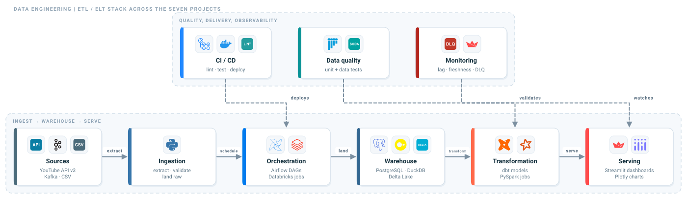
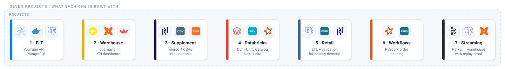

# Data Engineering Projects

  
  
  
  
  
  
  
  
  
  
  
  

A collection of hands-on data engineering projects covering ingestion, orchestration, transformation, warehousing, data quality, CI/CD, and lakehouse patterns — built with Python, SQL, Docker, Apache Airflow, dbt, DuckDB, PostgreSQL, PySpark, and Databricks.

## How the pipeline stack fits together

  

Every project below is a slice of this stack: something lands the data
(projects 1, 5 and 7), something stores it (1, 2 and 4), something transforms
it (2, 3, 4 and 6), and the quality, CI/CD and monitoring band is what makes
the result trustworthy.

  

*Editable draw.io sources: [`assets/diagrams`](../assets/diagrams).*

---

## Projects

| # | Project | What it demonstrates | Stack |
|---|---------|----------------------|-------|
| 1 | [ELT pipeline utilizing Python, Docker, and Apache Airflow](1.%20ELT%20pipeline%20utilizing%20Python%2C%20Docker%2C%20and%20Apache%20Airflow) | End-to-end ELT from the YouTube Data API v3 into a PostgreSQL warehouse, orchestrated with Airflow and validated with Soda checks and CI/CD | Python, Airflow, Docker, PostgreSQL, Soda, pytest, GitHub Actions |
| 2 | [Data Warehouse designed using DuckDB and Streamlit with CI-CD automation](2.%20Data%20Warehouse%20designed%20using%20DuckDB%20and%20Streamlit%20with%20CI-CD%20automation) | Local analytical warehouse with dbt staging/marts models, a Streamlit KPI dashboard, SQL linting, and a GitHub Actions pipeline | DuckDB, dbt, Streamlit, Plotly, sqlfluff, GitHub Actions |
| 3 | [Data Engineering Pipeline for Supplement Experiments](3.%20Data%20Engineering%20Pipeline%20for%20Supplement%20Experiments) | Cleaning and merging four related health/supplement datasets into a single analysis-ready DataFrame | Python, pandas, NumPy |
| 4 | [Databricks Projects](4.%20Databricks%20Projects) | Databricks / Delta Live Tables examples: Asset Bundles, data privacy, performance tuning, streaming, and CDC-driven ETL | Databricks, Delta Lake, Delta Live Tables, Spark SQL, Python |
| 5 | [Project Building a Retail Data Pipeline](5.%20Project%20Building%20a%20Retail%20Data%20Pipeline) | Extract → transform → load → validate pipeline for retail supply and demand analysis around public holidays | Python, pandas, PostgreSQL, Parquet |
| 6 | [Simple workflows](6.%20Simple%20workflows) | Focused, single-purpose data workflows, starting with PySpark order cleaning for a demand-forecasting model | PySpark, Python |
| 7 | [Streaming Pipeline - Kafka to Data Warehouse](7.%20Streaming%20Pipeline%20-%20Kafka%20to%20Data%20Warehouse) | Kafka → warehouse streaming with schema governance, dead-letter handling, watermarks, idempotent upserts, a live Streamlit monitoring dashboard, and a verified replay proof | Kafka (KRaft), Schema Registry, Python, PostgreSQL, dbt, Streamlit, Docker, GitHub Actions |

---

## How the projects are organised

* **Projects 1 and 2** are self-contained mini-repositories. Each has its own `README.md`, requirements file, source tree, and CI workflow, so they can be cloned and run independently.
* **Projects 3 to 6** are notebook-based exercises and workshop material. Each folder has its own `README.md` describing the scenario, the input data, the required output, and how to run the notebooks.

---

## Common prerequisites

* **Python 3.10+** with `pip`
* **Docker Desktop** — only required for project 1
* **A Databricks workspace with Unity Catalog** — only required for project 4
* **Jupyter** (or DataCamp Workspaces) to run the notebooks in projects 3, 5, and 6
