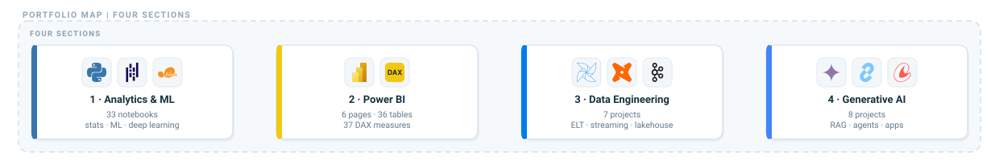

# Raivis — data analytics & engineering portfolio

Four sections: analysis notebooks, a Power BI report, production-shaped data
pipelines, and generative-AI projects. Each is documented, diagrammed, and
runnable on its own.

  
  
  
  
  
  
  
  
  
  
  
  

## What is in here

  

| # | Section | Inside |
|---|---------|--------|
| 1 | [Data Analytics & Machine Learning](1.%20Data%20Analytics%20%26%20Machine%20Learning%20Projects) | 33 notebooks: Python → pandas → statistics → scikit-learn → TensorFlow |
| 2 | [Power BI — visuals & DAX measures](2.%20Power%20BI%20-%20Visuals%20and%20DAX%20measures) | One 6-page report, 36-table model, 37 DAX measures ([preview](assets/images/PowerBI%20Demo%20Raivis.png)) |
| 3 | [Data Engineering](3.%20Data%20Engineering%20Projects) | 7 projects: ELT, dbt + DuckDB, Kafka streaming, Databricks |
| 4 | [Generative AI](4.%20Generative%20AI%20Projects) | 8 projects: MCP, RAG, LangChain, CrewAI, AutoGen/ADK, Django |

## Start here

* **Deepest single project** — the [Kafka → warehouse streaming pipeline](3.%20Data%20Engineering%20Projects/7.%20Streaming%20Pipeline%20-%20Kafka%20to%20Data%20Warehouse), with a verified replay proof.
* **Most visual** — the [Power BI report](2.%20Power%20BI%20-%20Visuals%20and%20DAX%20measures) and its [DAX catalog](2.%20Power%20BI%20-%20Visuals%20and%20DAX%20measures/DAX-MEASURES.md).
* **Widest stack** — [generative AI](4.%20Generative%20AI%20Projects), from an MCP server to a Django REST API.

---

Diagrams are hand-built SVGs with editable draw.io sources in [`assets/diagrams`](assets/diagrams); where the icons come from is documented in [`assets/README.md`](assets/README.md).

